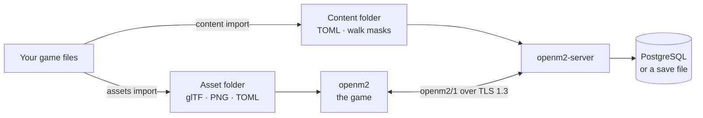

<h1 align="center"></h1>

<p align="center">
  <b>Our own open-source game engine: a client, a server and the protocol between them,<br>written from scratch in Rust.</b>
</p>

<p align="center">
  <a href="https://github.com/OpenM2-dev/openm2/releases/latest"></a>
  <a href="#license"></a>
  
</p>

<p align="center">
  <a href="https://github.com/OpenM2-dev/openm2/releases/latest/download/openm2-setup.exe"><b>Download for Windows</b></a> ·
  <a href="#run-your-own-server">Run a server</a> ·
  <a href="#documentation">Docs</a> ·
  <a href="docs/roadmap.md">Roadmap</a>
</p>

openm2 is a game engine of its own: a 3D client, a server that decides what happens in the world, and a protocol designed with them, all written from scratch in Rust. Client and server talk over TLS 1.3, players sign in without passwords, and the world is plain files you can edit.

> [!NOTE]
> **openm2 is early.** You can already walk the maps, fight with weapon combos and skills, level up, wear and upgrade items, shop, ride mounts, fish, warp, chat, whisper and keep friends. What comes next: [the roadmap](docs/roadmap.md).

## Highlights

**For players**
- 🎨 **Open formats.** The game plays from asset folders of glTF, PNG and TOML, which openm2 makes from your game files in about a minute.
- 🏠 **Singleplayer built in.** Play a world of your own on your computer, with no account and no internet, as its game master.
- 🔄 **Signed updates.** The launcher updates itself from manifests signed with Ed25519, and downloads only what changed.

**For server owners**
- 🔒 **TLS 1.3 on every connection.** A server is trusted by its certificate, or by its key the first time you join, as with SSH.
- 🔑 **No passwords to leak.** Players sign in with OpenID Connect (Google, Microsoft, GitLab, Keycloak, Clerk, …) or with their device's own key. The server stores no passwords at all.
- 🐘 **PostgreSQL.** Accounts and characters live in Postgres, its TLS checked by default, or in a single file for a small world.
- 🛡️ **The server decides.** It checks everything a client sends, works out every fight itself, and holds players and monsters to the maps' walls.
- 📝 **A world in plain files.** Spawns, drops, shops, starting items and skill training are TOML files you edit. Maps, monsters and items are imported from your game files beside them.
- 🐳 **Ready to deploy.** Each release publishes a small Docker image (distroless, non-root) to GHCR. A compose file runs it with Postgres, and OpenTelemetry carries its traces and metrics.

**Under the hood**
- 🦀 **Rust, from scratch.** Every parser returns an error instead of crashing on bad input, and property tests feed them random and damaged data.
- 📡 **A protocol of its own.** Versioned, declared in one file, generated into code and docs, with a byte-exact test for every message.
- 🧪 **Deterministic cores.** The client's and the server's logic never read a clock or touch a socket, so tests replay them exactly. A headless bot plays the real server in CI.

## How it works



The client and the server are built together and tested against each other. The design, and why it is so: [architecture.md](docs/architecture.md).

## Play

On Windows:

1. **Download [`openm2-setup.exe`](https://github.com/OpenM2-dev/openm2/releases/latest/download/openm2-setup.exe)** and run it. It installs openm2 for you alone, without an administrator. (Or unzip [`openm2-windows-x64.zip`](https://github.com/OpenM2-dev/openm2/releases/latest/download/openm2-windows-x64.zip) anywhere you can write.)
2. **Start openm2** and show it your game folder (the one with `pack` in it) and its keys file, [`keys.toml`](docs/specs/formats/keys.md). Browse to them, or drop them on its window.
3. **Wait about a minute** while it converts your game files, once. Later starts take a second or two.
4. **Pick Singleplayer** for a world of your own, or **Multiplayer** to join a server by its address.

## Run your own server

With Docker and PostgreSQL, on a Linux server:

1. **Register openm2 at an OpenID Connect provider** (Google, Microsoft, Keycloak, Clerk, …) as a desktop app, with PKCE and the redirect URI `http://127.0.0.1/callback`.
2. **Get the repo, and list the provider** in `local/providers.toml`:
   ```sh
   git clone https://github.com/OpenM2-dev/openm2.git && cd openm2 && mkdir -p local
   ```
   ```toml
   [[provider]]
   id = "google"
   name = "Sign in with Google"
   issuer = "https://accounts.google.com"
   client_id = "<your client id>.apps.googleusercontent.com"
   ```
3. **Import the world from your game files:** their maps, walk masks, monsters, items and skills. On Windows, in a folder where you unzipped [`openm2-windows-x64.zip`](https://github.com/OpenM2-dev/openm2/releases/latest/download/openm2-windows-x64.zip):
   ```powershell
   .\openm2.exe content import --client "C:\Games\My game" --keys "C:\Games\keys.toml" --out content
   ```
   Then copy the `content` folder to the server, as `local/content`.
4. **Start it:**
   ```sh
   cat > .env <<'EOF'
   OPENM2_DB_PASSWORD=<a long random password>
   OPENM2_PROVIDERS_FILE=./local/providers.toml
   OPENM2_CONTENT_DIR=./local/content
   OPENM2_PUBLISH=0.0.0.0
   EOF
   docker compose up --build -d             # Postgres, then the server
   docker compose run --rm server tls key   # the key to give your players: sha256:…
   ```

**Players** pick **Multiplayer** in openm2, press **Add** and type your server's address. At the first join they compare its key with the one you gave them. The server takes TCP ports 11002 and 13001; keep it on the latest release, as players' launchers update by themselves.

Your own certificate (Let's Encrypt works), a managed database, the published image, game masters, telemetry and every setting: [docs/server.md](docs/server.md).

### Make the world yours

Beside the imported files, the content folder takes files of your own: what monsters drop (`drops.toml`), what NPCs sell (`shops.toml`), what new characters start with (`start.toml`), and where monsters and NPCs stand (`spawns/*.toml`):

```toml
format = 1

[[group]]            # five of monster 101, in a circle of 12 metres
map = "<map>"        # a map's name, from maps.toml
at = [250, 80]
radius = 12
monster = 101
count = 5
```

`openm2-server content check content` says what a folder holds, and the server refuses a broken one, pointing at the file, line and column. Every file and rule: [docs/specs/server/content.md](docs/specs/server/content.md).

## Documentation

| | |
|---|---|
| [Running a server](docs/server.md) | Docker, PostgreSQL, TLS, sign-in, content, game masters, settings |
| [Building openm2](docs/building.md) | Building from source, and the tools: converters, viewers, the headless bot |
| [Architecture](docs/architecture.md) | The design, and why it is so |
| [Specs](docs/specs/) | The protocol, the file formats, the client, the server, updates |
| [Roadmap](docs/roadmap.md) | What works, what's next, open questions |
| [Source policy](docs/source-policy.md) | What may enter the repo |

## Contributing

openm2 is built to be maintained mostly by coding agents: small crates with one job each, fast deterministic tests, and one command, `just check`, that says whether a change is good. Start with [AGENTS.md](AGENTS.md), which has the rules and every command, and [docs/building.md](docs/building.md).

## Security

Get a server's key from its operator, not from the server itself. You sign in at your provider's own page, in your browser: openm2 never sees your password there, keeps no token, and stores no password of its own. The server knows you only by your id at that provider. How each part is protected: [architecture.md](docs/architecture.md#security).

## License

Dual-licensed under [MIT](LICENSE-MIT) or [Apache-2.0](LICENSE-APACHE), at your option.

The project's logo in [`branding/`](branding/) is not under these licences: you may show it unchanged to point at openm2, and builds and forks you ship use their own name and logo ([branding/README.md](branding/README.md)).
